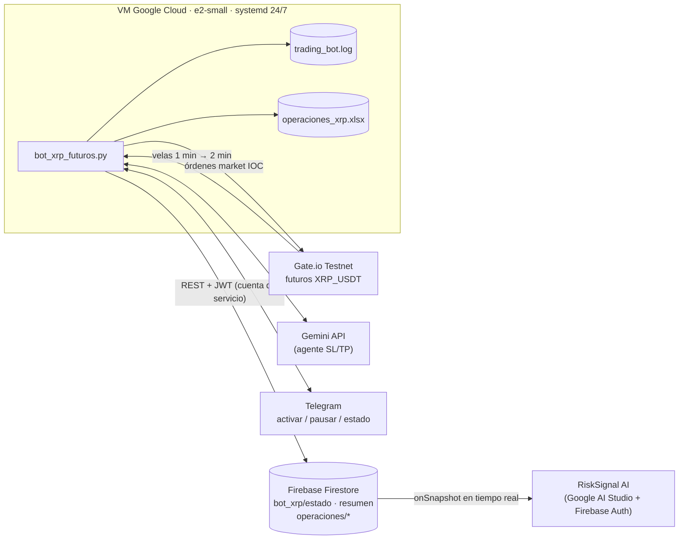
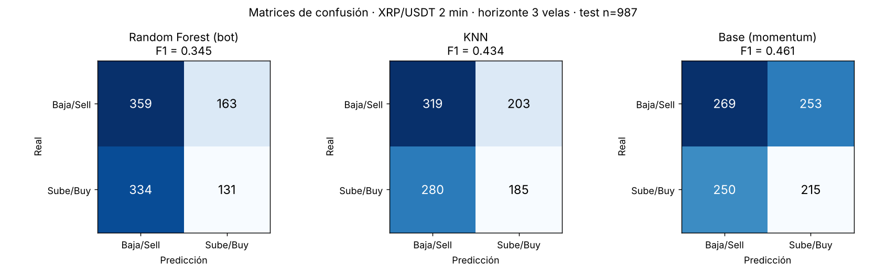
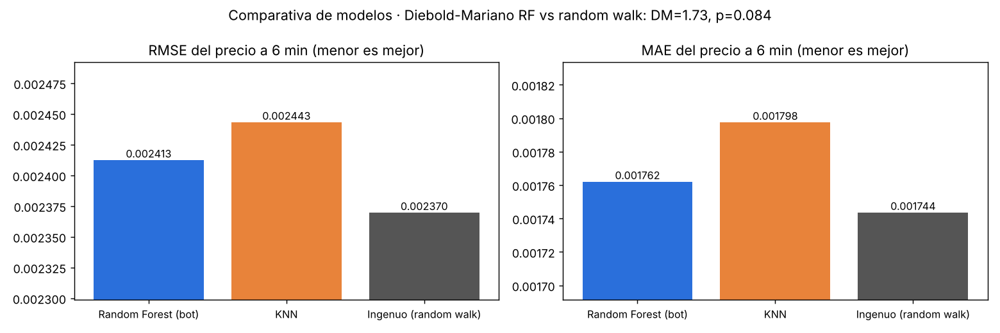
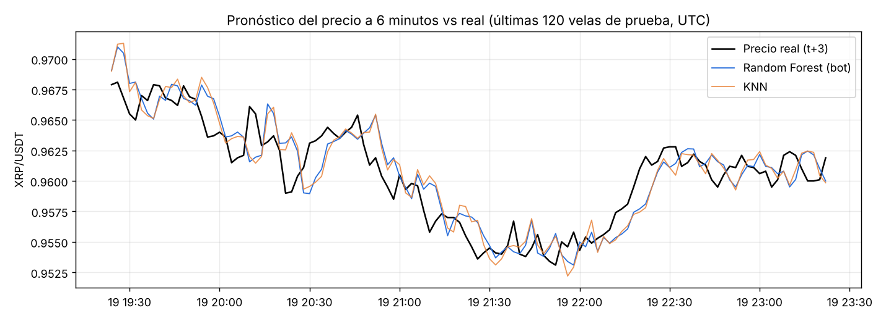
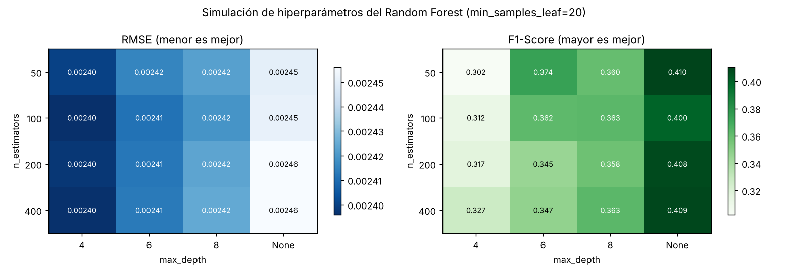
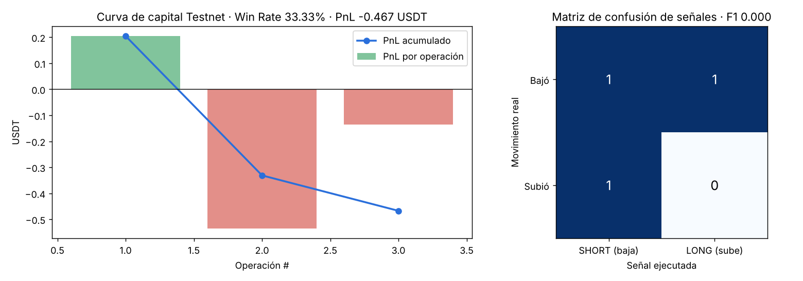

# Bot de trading XRP/USDT con IA en Google Cloud + RiskSignal AI

**Proyecto Final Integrador · Finanzas Computacionales, Algoritmos Cuantitativos e Inteligencia Artificial**
Autor: Patricio Castellanos · Defensa: 19 de noviembre de 2026

Bot algorítmico de **futuros perpetuos XRP_USDT** (velas de 2 minutos) que opera 24/7 en **Gate.io Testnet** desde una
**VM de Google Cloud**. Combina indicadores técnicos (EMA 9/21, RSI 14), un **Random Forest** que estima la probabilidad
de subida, gestión de riesgo con **VaR/CVaR 95 %**, un agente **Gemini** que valida cada señal y ajusta SL/TP, control por
**Telegram** y publicación en tiempo real a **Firebase Firestore**, de donde la app **RiskSignal AI** (Google AI Studio)
muestra el estado del bot y sus operaciones.

| | |
|---|---|
| App RiskSignal AI | https://remix-risksignal-ai-1695.ai.studio |
| Exchange | Gate.io **Testnet** · futuros USDT · contrato `XRP_USDT` |
| Servidor | Compute Engine `e2-small`, Ubuntu 22.04 LTS, disco 20 GB, servicio `systemd` 24/7 |

---

## 1. Cumplimiento de la rúbrica

| Requisito | Dónde está |
|---|---|
| Código modular y documentado | `bot_xrp_futuros.py` (secciones 1–10), `validacion_rf.py`, `analisis_testnet.py`, `graficas_validacion.py` |
| Notebook | `notebooks/validacion_modelo.ipynb` |
| Arquitectura | [§2](#2-arquitectura) |
| Fundamento matemático | [§3](#3-estrategia-y-fundamento-matemático) |
| Tabla de hiperparámetros | [§4](#4-hiperparámetros-del-bot) |
| Gestión de riesgo (SL/TP, VaR/CVaR, volatilidad, pausa por pérdidas) | [§5](#5-gestión-de-riesgo) |
| Validación ML: RMSE, MSE, MAE, MAPE, SMAPE, Variance Score | [§7.2](#72-regresión-precio-a-6-minutos) · `resultados/metricas_regresion.csv` |
| Validación ML: matriz de confusión, Accuracy, Precision, Recall, F1 | [§7.1](#71-clasificación-buysell) · `resultados/matrices_confusion.png` |
| **Test de Diebold-Mariano** | [§7.3](#73-test-de-diebold-mariano) · `resultados/diebold_mariano.csv` |
| Simulación de hiperparámetros del RF (tabla + gráfica comparativa) | [§7.4](#74-simulación-de-hiperparámetros-del-random-forest) · `resultados/hiperparametros.png` |
| Resultados en Testnet (matriz de confusión, ROI simulado) | [§8](#8-resultados-en-gateio-testnet) · `resultados/testnet_*` |
| VM 24/7 (e2-small, Ubuntu 22.04, systemd, `.env`, `trading_bot.log`) | [§9](#9-despliegue-en-google-cloud) · `setup_vm.sh` |
| Integración con app de IA (RiskSignal AI) | [§6](#6-integración-con-risksignal-ai-y-telegram) |

## 2. Arquitectura



Flujo de cada vela de 2 minutos:
1. Descarga velas de 1 min, arma la vela de 2 min **cerrada** y calcula EMA, RSI, rendimientos y volatilidad.
2. Re-entrena el Random Forest cada 30 min y estima `P(sube)` a 3 velas (6 min).
3. Calcula VaR/CVaR 95 % histórico (500 velas) y el filtro de volatilidad.
4. Si hay señal, consulta a Gemini (timeout 25 s; si falla, reglas por defecto) → `OPERAR/NO_OPERAR`, `k_sl`, `k_tp`.
5. Abre la orden en Testnet, vigila SL/TP cada 5 s, cierra por SL, TP o tiempo (15 velas) con `reduce_only`.
6. Registra en Excel, publica en Firestore, notifica por Telegram y escribe en `trading_bot.log`.

## 3. Estrategia y fundamento matemático

**Medias móviles exponenciales**
$EMA_t = \alpha P_t + (1-\alpha)EMA_{t-1}$, con $\alpha = 2/(n+1)$, $n \in \{9, 21\}$.

**RSI de Wilder (14)**
$RSI = 100 - \dfrac{100}{1 + \bar G / \bar L}$, con $\bar G, \bar L$ promedios exponenciales ($\alpha = 1/14$) de ganancias y pérdidas.

**Random Forest (clasificación)**
Objetivo $y_t = \mathbb{1}[P_{t+3} > P_t]$. Variables: rendimientos de 1, 2, 3, 6 y 12 velas, brecha EMA
$(EMA_9/EMA_{21} - 1)$, RSI, volatilidad de 12 velas y rango $(H-L)/C$.
$\hat p_t = \frac{1}{B}\sum_{b=1}^{B} \hat p_b(x_t)$ (promedio de $B=200$ árboles).

**Riesgo: VaR y CVaR históricos (95 %)** sobre los últimos 500 rendimientos $r$ de 2 min:
$VaR_{95} = -q_{0.05}(r)$, $\quad CVaR_{95} = -\mathbb{E}[\,r \mid r \le q_{0.05}(r)\,]$.

**Volatilidad** (igual que en la clase 10): $\sigma_{12} = \text{std}(P_{t-11..t}) / P_t \times 100$.

**Reglas de entrada**

| | LONG | SHORT |
|---|---|---|
| Tendencia | $EMA_9 > EMA_{21}$ | $EMA_9 < EMA_{21}$ |
| RSI | 45 – 70 | 30 – 55 |
| Random Forest | $\hat p \ge 0.55$ | $1-\hat p \ge 0.55$ |
| Volatilidad | $\sigma_{12} \le 0.60\%$ | $\sigma_{12} \ge 0.03\%$ |
| Agente Gemini | confirma `OPERAR` | confirma `OPERAR` |

## 4. Hiperparámetros del bot

| Componente | Parámetro | Valor |
|---|---|---|
| Datos | Temporalidad / contrato | 2 min (de velas de 1 min) / `XRP_USDT` futuros |
| Indicadores | EMA rápida / lenta · RSI | 9 / 21 · 14 |
| Random Forest | `n_estimators` · `max_depth` · `min_samples_leaf` | 200 · 6 · 20 |
| Random Forest | Horizonte · umbral de probabilidad · re-entrenamiento | 3 velas (6 min) · 0.55 · cada 30 min |
| Riesgo | VaR/CVaR · ventana | 95 % histórico · 500 velas |
| Riesgo | `k_sl` / `k_tp` por defecto · rango Gemini | 2.0 / 1.0 · 0.8 – 3.0 con $k_{tp} \le k_{sl}$ |
| Riesgo | SL / TP mínimos | 0.25 % / 0.15 % (cubren comisiones) |
| Riesgo | Salida por tiempo · pausa automática | 15 velas (30 min) · 4 pérdidas seguidas |
| Tamaño | Nocional por operación · apalancamiento | 100 USDT · 1x |
| Agente | Modelo Gemini · respaldo · timeout | `gemini-3.5-flash-lite` · `gemini-3.1-flash-lite`, `gemini-flash-latest` · 25 s |

## 5. Gestión de riesgo

* **Stop Loss y Take Profit dinámicos basados en VaR** (en lugar de ATR, porque el VaR mide directamente la pérdida
  de cola de la distribución de rendimientos de 2 min):
  * LONG: $SL = P_e(1 - k_{sl}\,VaR)$, $TP = P_e(1 + k_{tp}\,VaR)$
  * SHORT: $SL = P_e(1 + k_{sl}\,VaR)$, $TP = P_e(1 - k_{tp}\,VaR)$
* Gemini ajusta $k_{sl}, k_{tp}$ en $[0.8, 3.0]$; el código fuerza $k_{tp} \le k_{sl}$ y mínimos de SL/TP.
* **Filtro de volatilidad**: bloquea LONG en volatilidad extrema y SHORT en mercado sin movimiento.
* **Salida por tiempo** a las 15 velas para no quedar atrapado en rangos.
* **Circuit breaker**: tras 4 pérdidas consecutivas el bot se pausa solo y avisa por Telegram.
* Cierres con `reduce_only` y PnL oficial tomado de `list_position_close` (incluye comisiones).
* Llaves en `.env`, clave de Firebase en `firebase_key.json`; ninguna se sube al repositorio.

## 6. Integración con RiskSignal AI y Telegram

* El bot escribe en Firestore (base de la app) con un cliente REST propio firmado con JWT RS256 de la cuenta de servicio:
  `bot_xrp/estado` (precio, indicadores, señal, posición abierta), `bot_xrp/resumen` (Win Rate, PnL, profit factor,
  drawdown) y `operaciones/{0001…}` (cada operación cerrada).
* La pestaña **"Bot de trading"** de RiskSignal AI lee esos documentos con `onSnapshot` (tiempo real). Las reglas de
  Firestore solo permiten lectura a usuarios autenticados; la escritura es exclusiva del bot.
* Telegram (menú con botones): Activar/Pausar, EMA/RSI/VaR, Predicción RF, Gráfico, Agente Gemini, Parámetros,
  Operaciones, Exportar Excel, Cuenta Testnet, Estado y enlace a la cartera.

## 7. Validación del modelo

`validacion_rf.py` descarga **datos reales** de XRP_USDT (API pública de Gate.io), reconstruye exactamente las variables
del bot y evalúa el Random Forest contra **KNN** y contra modelos base. Partición **temporal** 80/20 sin mezclar, con
purga de 3 velas para evitar fuga de información.

* Datos: **4,935 velas de 2 min** del 13-nov-2026 02:54 al 19-nov-2026 23:22 UTC · train 3,945 / test 987.
* Ejecutado en la VM del proyecto (`resultados/metadatos.json`).

### 7.1 Clasificación (Buy/Sell)

| Modelo | Accuracy | Precision | Recall | F1-Score |
|---|---|---|---|---|
| Random Forest (bot) | 0.4965 | 0.4456 | 0.2817 | 0.3452 |
| KNN (k=25) | 0.5106 | 0.4768 | 0.3978 | 0.4338 |
| Base (momentum de 1 vela) | 0.4904 | 0.4594 | 0.4624 | 0.4609 |



### 7.2 Regresión (precio a 6 minutos)

| Modelo | RMSE | MSE | MAE | MAPE (%) | SMAPE (%) | Variance Score |
|---|---|---|---|---|---|---|
| Random Forest (bot) | 0.002413 | 5.820e-06 | 0.001762 | 0.1811 | 0.1811 | 0.9383 |
| KNN (k=25) | 0.002443 | 5.970e-06 | 0.001798 | 0.1847 | 0.1847 | 0.9367 |
| Ingenuo (random walk) | 0.002370 | 5.616e-06 | 0.001744 | 0.1792 | 0.1792 | 0.9405 |




### 7.3 Test de Diebold-Mariano

$d_t = e_{1,t}^2 - e_{2,t}^2$, $\;DM = \bar d / \sqrt{\hat V(\bar d)}$ con varianza de largo plazo (rezagos $h-1$) y
corrección de Harvey-Leybourne-Newbold, $h = 3$. H0: igual precisión predictiva.

| Modelo 1 | Modelo 2 | DM (HLN) | p-valor | Conclusión (α = 5 %) |
|---|---|---|---|---|
| Random Forest (bot) | Ingenuo (random walk) | 1.733 | 0.084 | Sin diferencia significativa |
| Random Forest (bot) | KNN | −1.372 | 0.171 | Sin diferencia significativa |
| KNN | Ingenuo (random walk) | 2.429 | 0.015 | El random walk es significativamente mejor |

### 7.4 Simulación de hiperparámetros del Random Forest

16 combinaciones (`min_samples_leaf = 20`). Tabla completa en `resultados/simulacion_hiperparametros.csv`.

| n_estimators | max_depth | RMSE | MAE | SMAPE (%) | Variance | F1 | DM vs ingenuo | p-valor |
|---|---|---|---|---|---|---|---|---|
| 50 | 4 | 0.002400 | 0.001755 | 0.1803 | 0.9389 | 0.302 | 1.37 | 0.171 |
| 100 | 4 | **0.002396** | **0.001752** | **0.1801** | **0.9391** | 0.312 | 1.31 | 0.191 |
| 200 | 4 | 0.002398 | 0.001754 | 0.1802 | 0.9390 | 0.317 | 1.38 | 0.169 |
| 400 | 4 | 0.002396 | 0.001753 | 0.1802 | 0.9391 | 0.327 | 1.35 | 0.178 |
| 200 | **6 (bot)** | 0.002413 | 0.001762 | 0.1811 | 0.9383 | 0.345 | 1.73 | 0.083 |
| 100 | 8 | 0.002419 | 0.001769 | 0.1818 | 0.9379 | 0.363 | 1.93 | 0.053 |
| 200 | 8 | 0.002423 | 0.001771 | 0.1821 | 0.9377 | 0.358 | 1.99 | 0.046 |
| 50 | None | 0.002450 | 0.001809 | 0.1859 | 0.9363 | **0.410** | 2.74 | 0.006 |
| 400 | None | 0.002456 | 0.001808 | 0.1858 | 0.9360 | 0.409 | 2.83 | 0.005 |



### 7.5 Interpretación

* A 6 minutos, **ningún modelo supera estadísticamente al random walk** (DM del RF p = 0.084). Es lo esperado en un
  mercado líquido con eficiencia débil: el precio actual ya contiene casi toda la información de corto plazo. El
  Variance Score alto (~0.94) se debe a que el nivel de precio es muy persistente, no a capacidad predictiva.
* Hay un **trade-off claro de hiperparámetros**: árboles poco profundos minimizan el error (RMSE) pero son
  conservadores (F1 bajo); árboles sin límite suben el F1 pero sobreajustan y el error empeora de forma
  significativa frente al random walk (p < 0.01). La configuración del bot (200 árboles, profundidad 6) está en el punto
  intermedio.
* Por eso el bot **no usa el Random Forest como señal única**: lo usa como filtro de confianza ($\hat p \ge 0.55$) junto
  con tendencia (EMA), momentum (RSI), volatilidad y el agente Gemini, y protege el capital con SL/TP basados en VaR.

Reproducir: `python validacion_rf.py` (requiere internet; ~5 min en la VM) o el notebook.
`python graficas_validacion.py` regenera las gráficas desde los CSV.

## 8. Resultados en Gate.io Testnet

`analisis_testnet.py` lee el Excel del bot y genera Win Rate, PnL, profit factor, drawdown, **ROI simulado** (sobre
100 USDT de margen por operación) y la **matriz de confusión de las señales ejecutadas** (dirección operada vs.
movimiento real entre entrada y salida). Corte del 19-nov-2026 (primeras operaciones del bot en la VM):

| Métrica | Valor |
|---|---|
| Operaciones cerradas | 3 (1 ganadora, 2 perdedoras) |
| Win Rate | 33.3 % |
| PnL neto | −0.467 USDT |
| Profit factor | 0.305 |
| Máximo drawdown | −0.672 USDT |
| ROI simulado acumulado | −0.47 % |



Detalle en `resultados/testnet_resumen.md`. El bot sigue operando 24/7; para actualizar:
`~/botenv/bin/python analisis_testnet.py` en la VM.

## 9. Despliegue en Google Cloud

| | |
|---|---|
| Máquina | `e2-small` (2 vCPU compartidas, 2 GB), zona `us-central1-f` |
| SO / disco | Ubuntu 22.04 LTS · 20 GB estándar |
| Ejecución 24/7 | servicio `systemd` **bot-xrp** con `Restart=always` |
| Secretos | `.env` (ver `.env.example`) + `firebase_key.json`, fuera del repositorio |
| Log | `trading_bot.log` junto al script |

```bash
# en la VM, dentro de ~/bot con los archivos del repo + .env + firebase_key.json
bash setup_vm.sh                       # venv ~/botenv, dependencias y servicio systemd
sudo systemctl status bot-xrp          # estado
tail -f ~/bot/trading_bot.log          # log en vivo
sudo systemctl restart bot-xrp         # reiniciar tras cambios
```

Alternativa con tmux: `tmux new -s bot "~/botenv/bin/python bot_xrp_futuros.py"`.

## 10. Estructura del repositorio

```
bot_xrp_futuros.py          bot completo (datos, indicadores, RF, riesgo, Gemini, órdenes, Excel, Firestore, Telegram)
validacion_rf.py            validación del modelo: métricas, matriz de confusión, Diebold-Mariano, hiperparámetros
graficas_validacion.py      regenera gráficas y resumen desde resultados/*.csv
analisis_testnet.py         resultados de Testnet: Win Rate, ROI, matriz de confusión de señales, curva de capital
notebooks/                  validacion_modelo.ipynb
resultados/                 CSV, gráficas PNG y resúmenes en Markdown
setup_vm.sh                 instalación en la VM + servicio systemd
requirements.txt            dependencias
.env.example                plantilla de variables de entorno
```

## 11. Limitaciones y trabajo futuro

* Testnet no replica la liquidez ni el deslizamiento reales; los resultados no garantizan desempeño en mercado real.
* Muestra de operaciones aún pequeña para conclusiones estadísticas sobre la estrategia.
* Probar horizontes más largos (15–60 min), variables de libro de órdenes y *walk-forward* para el re-entrenamiento.

> Proyecto académico en cuenta de prueba. No es asesoría financiera.
