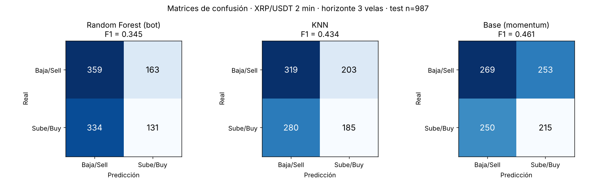
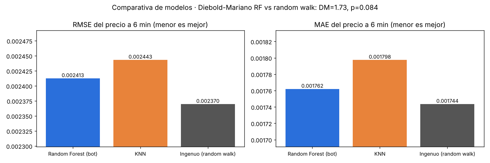
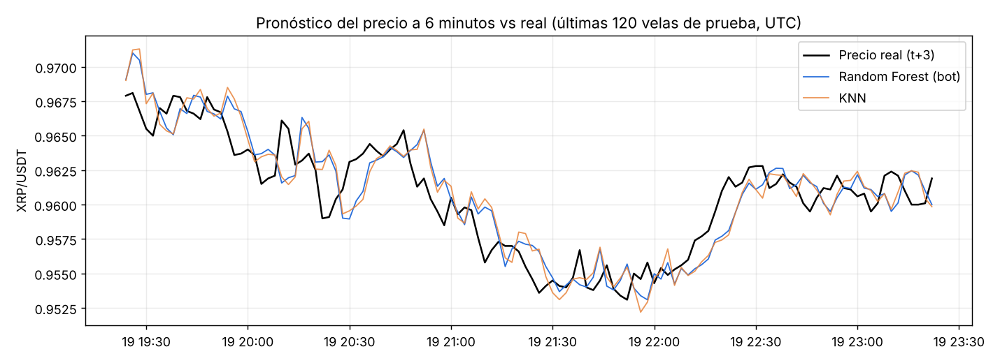
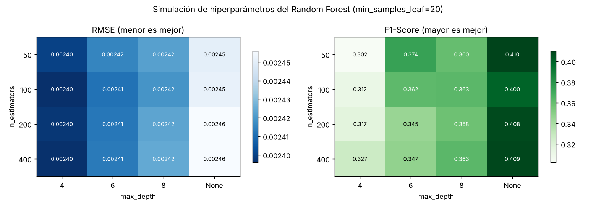

# Resultados de validación del modelo

- **Datos:** Gate.io API pública, futuros XRP_USDT · 4,935 velas de 2 min · 2026-11-13 02:54 → 2026-11-19 23:22 UTC
- **Partición temporal:** train 3,945 / test 987 (último 20 %), con purga de 3 velas
- **Objetivo:** dirección (clasificación) y precio (regresión) a 3 velas = 6 minutos

## Clasificación (Buy/Sell)
|                     |   Accuracy |   Precision |   Recall |   F1-Score |
|:--------------------|-----------:|------------:|---------:|-----------:|
| Random Forest (bot) |     0.4965 |      0.4456 |   0.2817 |     0.3452 |
| KNN                 |     0.5106 |      0.4768 |   0.3978 |     0.4338 |
| Base (momentum)     |     0.4904 |      0.4594 |   0.4624 |     0.4609 |

## Regresión (precio a 6 min)
|                       |       RMSE |         MSE |        MAE |   MAPE (%) |   SMAPE (%) |   Variance Score |
|:----------------------|-----------:|------------:|-----------:|-----------:|------------:|-----------------:|
| Random Forest (bot)   | 0.00241256 | 5.82046e-06 | 0.00176208 |    0.1811  |    0.181096 |         0.938274 |
| KNN                   | 0.00244336 | 5.97003e-06 | 0.0017976  |    0.18474 |    0.18475  |         0.936661 |
| Ingenuo (random walk) | 0.00236977 | 5.61583e-06 | 0.00174367 |    0.17921 |    0.179195 |         0.940496 |

## Test de Diebold-Mariano (pérdida cuadrática, corrección HLN, h=3)
| Modelo 1            | Modelo 2              |   DM (HLN) |   p-valor | Conclusión (α=5%)                                       |
|:--------------------|:----------------------|-----------:|----------:|:--------------------------------------------------------|
| Random Forest (bot) | Ingenuo (random walk) |     1.7327 |    0.0835 | Sin diferencia significativa                            |
| Random Forest (bot) | KNN                   |    -1.3716 |    0.1705 | Sin diferencia significativa                            |
| KNN                 | Ingenuo (random walk) |     2.4287 |    0.0153 | Ingenuo (random walk) tiene menor error (significativo) |

DM < 0 indica que el **Modelo 1** tiene menor error cuadrático que el Modelo 2.

## Simulación de hiperparámetros
|   n_estimators | max_depth   |       RMSE |         MSE |        MAE |   MAPE (%) |   SMAPE (%) |   Variance Score |   F1-Score |   Accuracy |   DM vs ingenuo |   p-valor DM |
|---------------:|:------------|-----------:|------------:|-----------:|-----------:|------------:|-----------------:|-----------:|-----------:|----------------:|-------------:|
|             50 | 4           | 0.00240007 | 5.76033e-06 | 0.00175466 |   0.180337 |    0.180329 |         0.938919 |   0.302358 |   0.490375 |         1.36899 |   0.171314   |
|             50 | 6           | 0.00241584 | 5.83626e-06 | 0.00176616 |   0.18152  |    0.181513 |         0.938113 |   0.373737 |   0.497467 |         1.82008 |   0.0690505  |
|             50 | 8           | 0.00242234 | 5.86774e-06 | 0.00177227 |   0.182149 |    0.182142 |         0.93778  |   0.360049 |   0.474164 |         1.98984 |   0.0468843  |
|             50 | None        | 0.00245047 | 6.00479e-06 | 0.00180892 |   0.185911 |    0.185909 |         0.936307 |   0.410194 |   0.507599 |         2.73955 |   0.00626346 |
|            100 | 4           | 0.00239594 | 5.74051e-06 | 0.00175245 |   0.18011  |    0.180104 |         0.939125 |   0.311978 |   0.499493 |         1.30829 |   0.191079   |
|            100 | 6           | 0.00241131 | 5.81439e-06 | 0.00176155 |   0.181048 |    0.181043 |         0.93834  |   0.361757 |   0.499493 |         1.69912 |   0.0896129  |
|            100 | 8           | 0.00241923 | 5.85268e-06 | 0.0017692  |   0.181836 |    0.181831 |         0.937938 |   0.362963 |   0.477204 |         1.93373 |   0.0534317  |
|            100 | None        | 0.00245132 | 6.00898e-06 | 0.00180399 |   0.185403 |    0.185403 |         0.936263 |   0.399516 |   0.497467 |         2.79438 |   0.00530081 |
|            200 | 4           | 0.00239774 | 5.74915e-06 | 0.00175372 |   0.18024  |    0.180234 |         0.939034 |   0.316804 |   0.497467 |         1.37685 |   0.16887    |
|            200 | 6           | 0.00241256 | 5.82046e-06 | 0.00176208 |   0.1811   |    0.181096 |         0.938274 |   0.345191 |   0.496454 |         1.73274 |   0.0834545  |
|            200 | 8           | 0.00242343 | 5.87303e-06 | 0.00177149 |   0.182068 |    0.182065 |         0.937715 |   0.357683 |   0.483283 |         1.99404 |   0.0464231  |
|            200 | None        | 0.00245591 | 6.0315e-06  | 0.00180767 |   0.185776 |    0.185778 |         0.936019 |   0.407674 |   0.499493 |         2.82594 |   0.00480949 |
|            400 | 4           | 0.00239631 | 5.74232e-06 | 0.00175291 |   0.180157 |    0.18015  |         0.939111 |   0.326975 |   0.499493 |         1.34935 |   0.177534   |
|            400 | 6           | 0.00241325 | 5.82377e-06 | 0.00176328 |   0.181222 |    0.181218 |         0.938243 |   0.34715  |   0.489362 |         1.75553 |   0.0794788  |
|            400 | 8           | 0.00242459 | 5.87865e-06 | 0.00177325 |   0.182246 |    0.182243 |         0.937657 |   0.362954 |   0.484296 |         2.01608 |   0.0440621  |
|            400 | None        | 0.00245598 | 6.03182e-06 | 0.00180754 |   0.18576  |    0.185763 |         0.936015 |   0.408551 |   0.495441 |         2.83149 |   0.00472736 |

Mejor combinación por RMSE: **n_estimators=100, max_depth=4**
(RMSE 0.00239594, F1 0.312).

