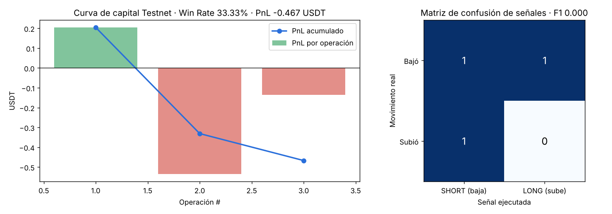

# Resultados en Gate.io Testnet

|                                |   valor |
|:-------------------------------|--------:|
| Operaciones cerradas           |  3      |
| Ganadoras                      |  1      |
| Perdedoras                     |  2      |
| Win Rate (%)                   | 33.33   |
| PnL neto (USDT)                | -0.4673 |
| Ganancia promedio (USDT)       |  0.2046 |
| Pérdida promedio (USDT)        | -0.3359 |
| Profit factor                  |  0.305  |
| Máximo drawdown (USDT)         | -0.6719 |
| ROI simulado por operación (%) | -0.1558 |
| ROI simulado acumulado (%)     | -0.4673 |

## Clasificación de señales

|           |   valor |
|:----------|--------:|
| Accuracy  |  0.3333 |
| Precision |  0      |
| Recall    |  0      |
| F1-Score  |  0      |

## Operaciones

|   # | Fecha entrada       | Posición   |   Precio entrada |   Precio salida |   PnL (USDT) | Motivo salida   |   RF P(sube) |   VaR95 % | Gemini                                                                                                         |
|----:|:--------------------|:-----------|-----------------:|----------------:|-------------:|:----------------|-------------:|----------:|:---------------------------------------------------------------------------------------------------------------|
|   1 | 2026-11-19 16:02:11 | SHORT      |           0.9554 |          0.9524 |      0.20461 | TP              |        0.382 |     0.216 | Tendencia bajista confirmada por EMAs y baja probabilidad de alza, ideal para venta en corto.                  |
|   2 | 2026-11-19 16:10:06 | SHORT      |           0.9552 |          0.9596 |     -0.53574 | SL              |        0.396 |     0.216 | Tendencia bajista confirmada con EMA lenta superior y baja probabilidad alcista.                               |
|   3 | 2026-11-19 16:34:08 | LONG       |           0.9616 |          0.9612 |     -0.13614 | Tiempo          |        0.58  |     0.216 | Tendencia alcista confirmada por EMAs y p_sube favorable. Relación k_tp <= k_sl prioriza probabilidad de éxito |
